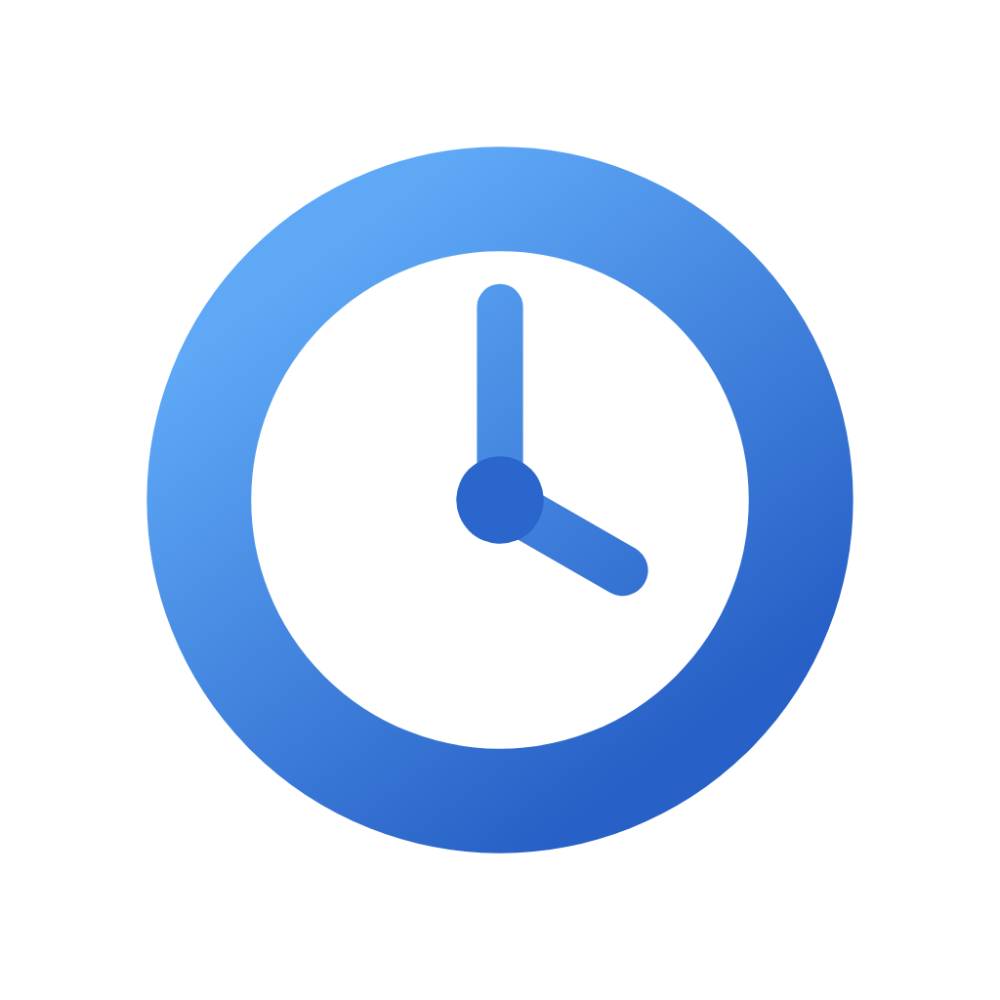

# his


Browser history archive & viewer.

[Website](https://noy4.github.io/his/)

## ✨ Features

- 🗄️ **Archive** — every browser's history into one file
- 📊 **Stats** — turns your history into charts and totals, per month or all time
- 🔁 **Automatic sync** — runs on a schedule

## 🖥️ Desktop app

A macOS menu bar app that runs the server for you.

1. **Download** — the DMG for your Mac from [Releases](../../releases) (`arm64` for Apple Silicon, macOS 12 or later)
2. **Launch** — on the security warning, click **Done** (not **Move to Trash**), then approve via **Open Anyway** in `System Settings → Privacy & Security`
    > **Note:** The app isn't verified by Apple — that requires joining the Apple Developer Program, $99/year
3. **Pick sources** — click the menu bar icon and choose **Open**, then select browsers in **Sources**

## ⌨️ CLI

```bash
npx @noy4/his --version           # try it without installing
npm install -g @noy4/his          # or install it globally
```

```bash
his serve --open                  # open the WebUI
his sources                       # list sources
his sources add chrome firefox    # enable targets (browser or browser:profile)
his sources remove chrome         # disable targets
his sync --target chrome          # sync Chrome once
his sync                          # sync selected sources
his query "sqlite"                # search the archive as JSON
his status                        # show the running server
```

Data is stored in `~/.his` (override with `--home` or `HIS_HOME`).

## 🛠️ Development

```bash
pnpm install
pnpm dev           # WebUI dev server + desktop app
```

## 🔗 Related projects

[joshuatownsend/chrome-history-explorer](https://github.com/joshuatownsend/chrome-history-explorer) — prior art: a browser history explorer (TypeScript). his skips some of those features (**AI interest maps**, **rabbit-hole detection**, **liveness checks**, etc.) and adds **continuous background sync** and a **macOS menu bar app**.

## ⚖️ License

[MIT](./LICENSE)
